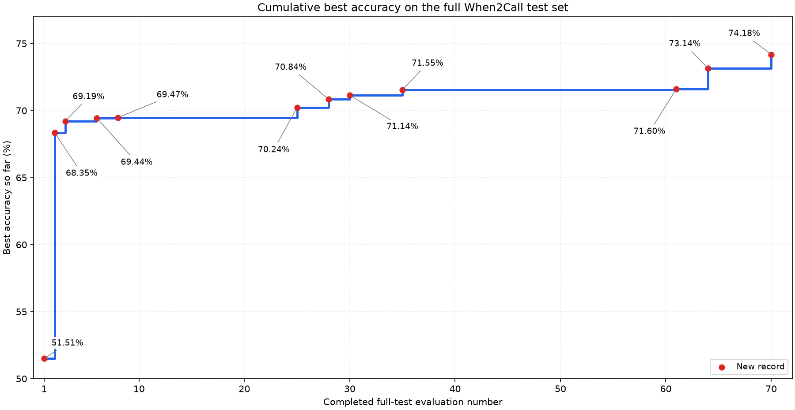

### TL;DR

I fine-tuned a 1.5B parameter Qwen model to strengthen performance on When2Call, a benchmark evaluating an Agent's ability to decide when to make tool calls. This model achieved 77.45% accuracy, matching or exceeding the performance of decision models at least 18x larger: Cloudflare's Clef (70.96%), OpenAI's GPT-6 Luna with the Decision API (74.06%), and Perplexity's Decider v1.1 27B (76.5%)

I was able to obtain these results more quickly after building an auto-research loop, allowing Codex to automatically explore strategies for optimizing training and inference. The second half of this blog post will dive into the design of the loop, highlighting what worked well and what did not.

### Part One: training a decision model

#### Motivation

A tool-using agent must decide on each turn whether to answer, call a tool, ask for missing information, or say that it cannot help with the available tools. This is a frequent decision, so even a small per-turn cost can add up across a long agent run.

A small model is an attractive option for this task. The output has only a few valid choices, so the model does not need to generate a long response. The same constraint also makes training data easier to label and evaluation easier to automate. These properties make tool-use decisions a useful target for task-specific fine-tuning.

#### Dataset

When2Call measures whether a model chooses the right action, rather than whether it can produce a valid tool call once it has decided to call one. Each example describes a conversation and available tools. The model chooses among four responses: answer directly, call a tool, ask for more information, or say that it cannot answer with the available tools.[1](#ref-1)

A simplified example is:

```text
User: What is the sum of 133 and 34?
Available tool: sum_numbers(numbers_list)

Choices:
A. Call sum_numbers with [133, 34].
B. Ask the user to provide the numbers as a list.
C. Answer that the sum is 167.
D. Say that the assistant cannot perform calculations.

Correct choice: A
```

The original When2Call training data was enough to fit its own distribution. On a held-out split from that source, the model reached above 95% accuracy on both training and validation. The remaining errors on the external test set therefore appeared to be a data-distribution problem, rather than a sign that the training objective or inference procedure needed a major redesign.

I tried adding several existing open datasets to the training mixture. They did not improve external test performance. Their examples differed from When2Call in format and decision boundaries, so they did not provide the kind of additional signal the model needed. This led me to generate new examples that retained When2Call's task format while varying the underlying scenarios.

The synthetic data covered four strategies: requests that require a tool call with a new request and existing tool set, requests that omit a required argument, requests for capabilities that no available tool can provide, and requests over composed tool sets. I anchored generation in real training prompts and tool schemas, then asked a model to produce a new scenario with a specified correct action. A separate label check and structural validation filtered the generated candidates. The prompts are included in the appendix.

#### Setup

I first fine-tuned `Qwen2.5-1.5B-Instruct` on the original When2Call preference data. I then continued from the selected original-data checkpoint using only the synthetic examples. This isolated the effect of the new data from replaying the original training set.

The main continuation used one epoch per synthetic data family. The training code used supervised fine-tuning with AdamW, a learning rate of 2 × 10⁻⁵, weight decay of 0.01, batch size 1, sequence length 4,096, and LoRA rank 16. The fixed clean-validation sample contained up to 500 examples. Synthetic training diagnostics also used up to 500 rows. Later full-test evaluations contained 3,652 examples. The training setup and evaluation records are in the post-training repository.

#### Results

Artificial Analysis evaluates 3,423 When2Call examples. It excludes 229 “ask for more information” examples that it considers ambiguous, and it shuffles the answer choices.[2](#ref-2) The scores below for its decision models use that evaluation. Artificial Analysis publishes accuracy for this benchmark, but not macro F1, so those cells are left blank. Model size is shown only where it is available from the model name or the cited model description.

| Model | Parameters (B) | Accuracy | Cost per 1M tasks (USD) |
| --- | ---: | ---: | ---: |
| Elephant 9B | 9 | 94.77% | 8.39 |
| SubQ Snap 1.1 | — | 94.57% | 30.34 |
| Drex Max | — | 93.98% | 23.03 |
| d1-ultra | — | 92.58% | 31.80 |
| Decider v1.2 | — | 87.70% | 15.14 |
| Drex 2.0 | — | 86.15% | 41.36 |
| Drex 1.5 | — | 84.81% | 34.47 |
| Celeris-1 Decision | — | 83.70% | 31.57 |
| GLiDE | — | 83.67% | 119.02 |
| Microsoft-Decision-1 | — | 81.92% | 30.71 |
| Jev 1.14 | — | 80.84% | 41.53 |
| Jev 1.13 | — | 80.66% | 41.53 |
| Mercury Decide | — | 79.26% | 15.20 |
| **Fine-tuned Qwen, synthetic continuation** | **1.5** | **77.45%** | **3.09 (estimated)** |
| d1 | — | 77.42% | 15.14 |
| Decider v1.1 27B | 27 | 76.48% | 16.53 |
| Decider Flash v1.2 | — | 74.41% | 8.23 |
| GPT-6 Luna (Decisions) | — | 74.06% | 78.87 |
| Clef | 27 | 70.96% | 199.41 |
| **Fine-tuned Qwen, original data only** | **1.5** | **70.24%** | **—** |
| Clef-Flash | — | 64.36% | 31.57 |
| Clef-Omni | — | 62.05% | 123.08 |

The Qwen original-data row uses the full 3,652-example test score. The synthetic continuation reached 74.18% on that same full test set. Its 77.45% score above is the later rescore on Artificial Analysis's 3,423-example subset. The full-set and subset scores use different denominators, so the difference is not a direct measure of model improvement. Macro F1 for the full-set Qwen evaluations uses all four labels.

The main takeaways are:

- The 1.5B Qwen is about 18 times smaller than Clef and the 27B Decider v1.1. It scores 6.49 percentage points higher than Clef and 0.97 points higher than Decider v1.1 in the comparison above.
- The Qwen is an order of magnitude smaller than GPT-6 Luna, and its score is close to the Decision API result.
- Training on the original When2Call data alone reached 70.24% accuracy on the full test set. Continuing training on synthetic data raised it to 74.18%, a gain of 3.94 percentage points on the same 3,652 examples. The 77.45% result is the later score on Artificial Analysis's smaller 3,423-example subset.
- The Qwen does not beat every larger model. Baseten's Elephant 9B is six times larger and scores 94.77%, 17.32 percentage points higher than the Qwen.[2](#ref-2)

The cost estimate for Qwen depends on the local inference setup. Artificial Analysis reports cost at its current published prices, so its hosted-model figures are not a direct deployment quote for another provider or hardware setup.[2](#ref-2)

This chart compares When2Call accuracy with estimated cost per million tasks. The hosted-model points use Artificial Analysis estimates. The Qwen point uses the earlier $3.09 per million task estimate for the local model setup. The horizontal axis is logarithmic because the costs span a wide range. The star marks our fine-tuned model. The other points are the decision models in the table above.[2](#ref-2)


### Part Two: auto-research

#### Motivation

The Bitter Lesson argues that methods that scale with computation tend to outperform methods that depend on hand-built human knowledge.[3](#ref-3) I see the same pressure in model research. If a coding agent can write and run experiments, a human who still has to implement every experiment becomes the limiting step.

For this project, I used GPT-6 Luna at medium reasoning through Codex. The goal was to turn a broad research direction into a repeated loop of hypotheses, code changes, runs, and analysis. Each project should leave the loop easier to reuse on the next one.

#### Design

The loop had three parts:

1. **Researcher.** The Codex session proposed and ran experiments, inspected aggregate results, and updated the research record.
   - It used a persistent prompt that defined the task, data restrictions, evaluation procedure, and required experiment records.
   - I gave it a family of approaches to explore, then let it choose specific experiments within that family.

2. **Watchdog.** A background process checked that the declared experiment worker and research state remained active.
   - It checked process state and the worker heartbeat on a short interval.
   - If a declared worker exited or became stale, it recorded the condition and initiated recovery.

3. **Supervisor.** A separate process kept the watchdog alive.
   - It checked the watchdog process and heartbeat.
   - If the watchdog stopped or became stale, it restarted the watchdog and recorded the restart.

The extra processes addressed a failure I saw in early runs. The research session often stopped after a few hours, sometimes after finishing a planned batch. It was not clear why it chose to stop. When no one was at the computer to prompt it to continue, the experiments remained idle. The watchdog and supervisor made worker recovery more reliable, while the research prompt told the session to keep planning when the experiment queue was empty.

#### Implementation

The researcher prompt set out the objective, source datasets, evaluation rules, and requirements for each experiment. It asked Codex to change one factor at a time where possible, record the configuration and result, and use validation for candidate selection. The prompt also required aggregate-only reporting for the hidden test set and prohibited saving individual test examples or predictions. Later synthetic-data runs followed a separately authorized rule that used aggregate test accuracy to decide whether to continue that branch. The full prompt is included in the appendix.

The watchdog was implemented as a Python process that read the research state, checked the active worker's operating-system process state and heartbeat, and recorded failures. The independent supervisor polled the watchdog and restarted it when its process or heartbeat failed. These processes did not choose the next research direction. That remained the responsibility of the Codex researcher and the human who supplied the next family of ideas.

#### Results

The loop made it practical to explore many variants without manually writing each training command or waiting beside the machine. Across the complete test evaluations, performance moved from 51.51% in the first logged evaluation to 74.18% at the best full-set result. That number includes a broad sequence of encoder, Qwen, and synthetic-data work. It should not be read as a controlled measure of the auto-research loop alone. The model, data, and evaluation strategy all changed during the project.


The table counts distinct completed training runs in the experiment ledger. I grouped runs by their training workflow, so each run is counted once. The counts exclude validation-only screens, evaluation-only runs, queued work, and failed or incomplete runs.

| Experiment family | Completed runs | What I tried |
| --- | ---: | --- |
| Initial Qwen SFT and RPO | 7 | Compared supervised fine-tuning and reward-aware preference optimization on the original When2Call data at small model sizes. |
| Qwen full-data training and continuations | 197 | Tested preference-data sample sizes, source mixtures, synthetic strategies and doses, learning rates, and checkpoint continuations with the Qwen 1.5B workflow. |
| Glaive and When2Call mixtures | 13 | Added Glaive examples to When2Call training and tested whether this broader mixture improved the decision task. |
| General dataset continuations | 8 | Continued training on additional datasets and checked whether their distributions transferred to When2Call. |
| BFCL and When2Call mixture | 1 | Tested a combined training set from BFCL and When2Call. |
| Learned ensemble stackers | 2 | Trained small learned combiners to combine model predictions. |

These counts describe training runs, not the 70 full-test evaluations shown in the chart below. The ledger also contains other completed runs outside this table, such as data preparation and model evaluation.


I rebuilt this curve from the chronological experiment ledger. It includes 70 completed evaluations, each on all 3,652 test examples. The graph plots the best accuracy reached so far after each full-set evaluation. It is a step plot: the record increased on evaluations 1, 2, 3, 6, 8, 25, 28, 30, 35, 61, 64, and 70, and stayed flat on the other 58. The points are not interpolated between runs. The 76.2% unsupported-capability pilot used only 500 examples, so it is not included.



The full-set sequence began with an encoder baseline, moved through fusion, Qwen training, and routing experiments, and ended with synthetic-data continuation. It reached 74.18% at evaluation 70. The earlier 76.2% score came from the 500-example screen. It did not set the full-set record.

The synthetic-data phase showed the value and the limits of this process. The unsupported-capability pilot reached 76.2% on a 500-example screen, which justified a larger run under the then-current experiment rule. Other synthetic families did not produce the same signal. The larger experiments used the complete test set, and their best result was 74.18%. This demonstrates why a promising pilot needs a larger, consistently evaluated follow-up.

#### Learnings

The system still needed human direction. I usually chose the broad family, such as synthetic data or ensembling. The researcher was useful at exploring variants within that family, but it did not reliably decide which new family should come next. I acted more like a research lead setting a direction than a fully hands-off user.

The choice of researcher model also mattered in practice. GPT-6 Luna at medium reasoning was affordable enough to leave active for long runs, but I do not know whether a stronger model would have proposed better experiment families or analyzed results more efficiently. A future loop could reserve a more capable model for idea generation and error analysis while using a cheaper model for routine implementation. The cost of repeatedly sending a large context would need to be measured.

Continuous experimentation also changes how the work feels. The machine can run for long periods, while the human checks in periodically to see whether the current direction remains useful. This is less like one focused coding session and more like supervising a process over time.

The hardest open question was how long to stay within one family. The researcher tended to keep trying variants after I would have moved on. A fixed experiment budget would prevent that, but it could also cut off a promising direction too early. A better system would estimate when a family has stopped producing useful results and explain why it should switch.

Long sessions raised a context-retention problem. The researcher sometimes lost earlier guidance after a long run. A searchable record of prior sessions could let a fresh session retrieve decisions and results without carrying the full history in its active context.

Finally, the system was better at combining familiar techniques than proposing genuinely novel ones. Prompting for creativity did not solve this. An adversarial idea-generation or critique stage may help, but it would need to be judged by whether it proposes useful experiments, not whether the ideas sound unusual.

#### References

<a id="ref-1"></a>

1. Hayley Ross, Ameya Sunil Mahabaleshwarkar, and Yoshi Suhara. [“When2Call: When (not) to Call Tools.” NAACL 2025.](https://aclanthology.org/2025.naacl-long.174/)

<a id="ref-2"></a>

2. [Artificial Analysis, When2Call Benchmark and methodology.](https://artificialanalysis.ai/evaluations/when2call)

<a id="ref-3"></a>

3. Rich Sutton. [“The Bitter Lesson.”](http://www.incompleteideas.net/IncIdeas/BitterLesson.html)

#### Appendix

##### Prompts for synthetic dataset generation

The generator used real training requests and tool schemas as context. The shared instruction and each strategy-specific instruction are shown below. The model returned one new request and structured metadata. A separate judge classified the request using only the request and available tools. Structural checks then verified the target label and tool arguments.

```text
Action labels:
- cannot_answer: The request needs a capability that none of the tools provide, and it cannot be answered directly from the request.
- request_for_info: A tool can do the task, but a required input is missing and cannot be inferred.
- tool_call: A listed tool is needed and the request gives enough information to use it.
- direct: The request can be answered without a tool.

Create a genuinely new user request, not a paraphrase or small edit of the source request. Stay close to the source task style and complexity. Keep every available tool schema exactly as provided. Return one request only, with no answer.

Strategy instruction:
- New tool call: The target action is tool_call. Choose one listed tool. The request must clearly require it and include all facts needed for the required arguments.
- Missing required information: The target action is request_for_info. Choose one listed tool with a required field that has no default. The request must need that tool, provide the other required facts, and omit one required value that cannot be inferred. Name the omitted field.
- Unsupported capability: The target action is cannot_answer. Ask for an action that none of the listed tools can perform and that cannot be answered from stable knowledge in the request. Do not ask for a tool-supported task.
- Composed tools: The target action is tool_call. The available tools combine two source tool sets. Choose one tool and create a new request that needs that tool, distinguishes it from the other tools, and supplies all facts required for its arguments.

Source context:
{"source_requests": ["<source request>", "<source request>"], "available_tools": ["<unchanged tool schemas>"], "target_action": "<target label>"}
```

The generator required a structured response with these fields:

```json
{
  "request": "A new user request",
  "action_label": "tool_call | request_for_info | cannot_answer | direct",
  "selected_tool_name": "A listed tool, if required",
  "arguments_json": "A JSON object encoded as a string",
  "missing_required_argument": "The omitted required field, if any",
  "new_scenario_note": "A short note about what makes the scenario new"
}
```

The independent label check hid the requested target action from the judge:

```text
Classify the required assistant action for this new example. Decide from the request and tools only.
{"request": "<generated request>", "available_tools": ["<unchanged tool schemas>"]}
```

##### Prompts for auto-research loop

The operating prompt changed as the project moved through new experiment families. The version below combines the standing instructions used in the open-ended research phase. It omits stale queue entries and machine-specific commands, but preserves the research and monitoring rules that shaped the loop.

```text
You are an autonomous AI research engineer. Improve performance on the When2Call benchmark through empirical research. Do not stop after one successful or unsuccessful experiment.

Research loop
1. Review the latest experiment records, metrics, and unresolved errors.
2. Propose distinct, falsifiable hypotheses across data, training, models, and inference. Explain why each may help and define a success criterion.
3. Start with a small number of low-cost, structurally different tests. Expand a direction only when results support it. Do not repeat an experiment with only a different random seed.
4. Change one relevant factor at a time when practical. Keep other settings fixed. Justify changes to learning rate, batch size, optimizer, weight decay, or epoch count with recorded evidence.
5. Implement the experiment, verify that the intended process is running, and record its configuration, data, checkpoint, metrics, and outcome.
6. After a worker finishes, analyze the result and plan the next useful experiment. An empty queue is a request for research planning, not a reason to stop.

Evaluation rules
- Use clean held-out validation and declared training diagnostics to select checkpoints and methods.
- Treat the official test set as a black-box evaluator. Report only aggregate accuracy, macro F1, example count, and runtime. Do not inspect or save individual test examples, labels, predictions, correctness, confusion matrices, or error slices.
- Keep test results separate from candidate selection unless a specific experiment has an explicit test-based continuation rule.
- Record limitations and evaluation-set differences with each reported result.

Data and execution
- Generate new examples from training data only. Keep the task format and complexity close to When2Call while testing new scenarios.
- Validate generated examples for structure and labels before training.
- Keep API spend within the approved budget and record usage.
- Run one GPU training or evaluation worker at a time. Keep experiment records durable and resumable.

Monitoring
- A watchdog checks the declared worker, operating-system process state, research state, and heartbeat every 30 seconds.
- A separate supervisor restarts the watchdog if it exits or its heartbeat becomes stale.
- Verify every launch and restart by checking the process, command, and updated log or heartbeat. Record recovery actions.
- The watchdog recovers execution. The researcher plans experiments. When the queue is empty, the researcher must review results and add the next justified experiment.
```

This is an edited public version of the working prompt. The original prompt accumulated run-specific instructions as the research progressed.
