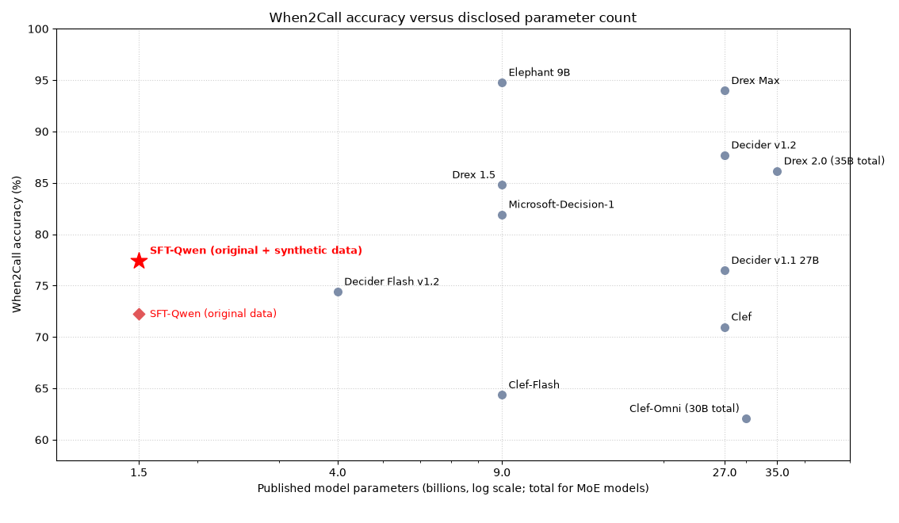

### TL;DR

I fine-tuned a 1.5B Qwen model to strengthen performance on When2Call, a benchmark evaluating an Agent's ability to decide when to make tool calls. This model **achieved 77.45% accuracy, matching or exceeding the performance of decision models at least 18x larger:** Cloudflare's Clef (70.96%), OpenAI's GPT-6 Luna with the Decision API (74.06%), and Perplexity's Decider v1.1 27B (76.5%)

I was able to obtain these results more quickly after **building an auto-research loop**, allowing Codex to automatically explore strategies for optimizing training and inference. The second half of this blog post will dive into the design of the loop, highlighting what worked well and what did not.

### Part One: our decision model

Throughout multiple steps of the Agent loop, the Agent must decide whether to answer the user's request, call a tool, ask for missing information, or refuse the request. This decision occurs frequently enough that even a small per-turn cost can add up across a long horizon. As such, offloading this decision to a cheap model is an attractive option. This blog post focuses on squeezing the best performance out of one of the cheapest models.

Supervised Fine-tuning (SFT) on open-source models is a standard approach to match the performance of frontier models on specialized tasks at cheaper cost. SFT is especially attractive for decision models due to the ease of obtaining and learning from supervised labels here. The output only has a few discrete valid options. As such, producing the labels does not require as much effort, either in the form of labor cost from human data labelers or compute costs from synthetic dataset generation.

#### Dataset

**Original Dataset:**

[When2Call](https://aclanthology.org/2025.naacl-long.174/) measures whether a model selects the correct action when deciding whether or not to invoke tool calls. Each example describes a conversation and available tools. The model chooses among four responses: answer directly (`direct`), call a tool (`tool_call`), ask for more information (`request_info`), or say that it cannot answer with the available tools (`cannot_answer`).

A simplified example is as follows:

```text
User: What is the sum of 133 and 34?
Available tool: sum_numbers(numbers_list)

Choices:
A. Call sum_numbers with [133, 34].
B. Ask the user to provide the numbers as a list.
C. Answer that the sum is 167.
D. Say that the assistant cannot perform calculations.

Correct choice: A
```

We trained on the 9,000-example `train_pref` split of the [When2Call dataset](https://huggingface.co/datasets/nvidia/When2Call) and evaluated on its 3,652-example `test/mcq` split. To match the [Artificial Analysis evaluation](https://artificialanalysis.ai/evaluations/when2call), we excluded the 229 ambiguous `request_for_info` examples, leaving 3,423 scored examples.

**Synthetic dataset**

When training on the original When2Call training dataset, our model quickly learned the data distribution. We split out the `train_pref` data into training data and a smaller held-out validation set, and after a single epoch of training, we achieved above 95% accuracy on both splits. However, the accuracy on the actual test data was lower at approximately 70%. These results together suggested that although the training setup was close to optimal, the underlying data came from a different distribution than the test set.

We first tried introducing several existing open datasets to the training mixture. They did not improve test performance. Their examples differed from When2Call in format and decision boundaries, and therefore they did not provide the kind of additional signal the model needed. The open datasets we tested included [Glaive](https://huggingface.co/datasets/glaiveai/glaive-function-calling-v2), [BFCL](https://gorilla.cs.berkeley.edu/leaderboard), [APIGen-MT](https://huggingface.co/datasets/Salesforce/APIGen-MT-5k), and [ToolACE](https://huggingface.co/datasets/Team-ACE/ToolACE).

The failure of these datasets pushed me towards generating synthetic data. If we could not find an open-source dataset drawn from the correct distribution, why not create one ourselves? We used GPT-6 Luna as our dataset generator model. Although we tried various approaches to generating synthetic examples, we eventually landed on the following approach:
1. Select an existing example from the dataset to use as a source example.
   - The standard approach was to select uniformly at random.
   - Optionally: sort examples from highest to lowest with respect to the number of available tools in the example, then do selections in that order. Intuitively, this metric is likely a proxy for example difficulty.
2. Feed the source example into the dataset generator LLM.
   - Specifically, we give the LLM the source example, the tool schemas, and the selected tool name.
   - There are then two possible paths for generation:
     - If the example is labeled `tool_call`:
       - Generate a new example in the same broad domain as the source, but not paraphrase.
       - Generate a second example near-identical to the first but with one modification: omit exactly one required input with no default. The correct action is to ask for missing information.
     - If the example is labeled `cannot_answer`:
       - Generate a new example in the same broad domain as the source, but the where the content of the user request is such that none of the tools can handle it. The correct action is to refuse to answer.
     - If not, skip.
3. Send the generated examples and the tool schemas to a separate verifier LLM.
   - The verifier does not see the intended labels. Instead, the verifier must independently confirm the actions.
   - For a pair, the verifier must additionally confirm that both examples express the same task and differ by only one missing required input.
   - Filter out all examples that the verifier does not assign a high-confidence judgment to.
4. Have the verifier LLM apply a second round of filtering:
   - For pairs, check that the selected tool, missing required input, and argument objects match the supplied schema. Reject structurally invalid or duplicate requests.
5. Move all non-filtered rows into the synthetic training set.
6. Optionally: pick only the most similar synthetic examples.
   - Rank all synthetic examples by lexical Jaccard similarity to their corresponding source examples. Then prioritize selecting the examples in order of this rank.

#### Experimental details

The highest performing experiment involved multiple epochs of fine-tuning on different mixes of data.
1. Train for 2 epochs on all 9,000 examples in the When2Call `train_pref` split.
2. Train for 1 epoch on 900 sampled When2Call `train_pref` examples and 450 synthetic examples.
   a. During synthetic dataset generation, the source examples were selected uniformly at random and the synthetic examples were prioritized by similarity.
3. Train for 1 epoch on a new pool of 994 synthetic examples.
   a. During synthetic dataset generation, the source examples were selected according to number of tool, and the synthetic examples were not prioritized by similarity.
4. Train for 1 epoch on another fresh pool of 983 synthetic examples.
   a. Synthetic dataset generation process was the same as above.

The original-data baseline and synthetic continuation used these hyperparameters:

| Setting | Value |
| --- | --- |
| Base model | Qwen2.5-1.5B-Instruct |
| Original-data baseline | 1 epoch on When2Call preference data |
| Best synthetic continuation | 1 epoch on 983 fresh tool-rich synthetic examples |
| Starting checkpoint | Epoch 1 of an earlier synthetic-only tool-rich run |
| Optimizer | AdamW |
| Learning rate | 2 × 10⁻⁵ for original-data training; 5 × 10⁻⁶ for the best continuation |
| Weight decay | 0.01 |
| Batch size | 1 |
| Maximum sequence length | 4,096 tokens |
| LoRA rank | 16 |
| Clean validation sample | Up to 500 examples |

Training code and evaluation records are in the [post-training repository](https://github.com/kunal-sinha-coding/post-training).

#### Results

Our methods are listed in bold in the table below. Unknown parameter counts are shown as `--`.

| Model | Accuracy | Parameters |
| --- | ---: | ---: |
| Clef-Omni | 62.05% | [30B total (3B active)](https://developers.cloudflare.com/workers-ai/models/clef-omni/) |
| Clef-Flash | 64.36% | [9B](https://blog.cloudflare.com/clef-decision-models/) |
| Clef | 70.96% | [27B](https://blog.cloudflare.com/clef-decision-models/) |
| **SFT-Qwen (original data)** | **72.24%** | [1.5B](https://huggingface.co/Qwen/Qwen2.5-1.5B-Instruct) |
| GPT-6 Luna (Decisions) | 74.06% | -- |
| Decider Flash v1.2 | 74.41% | [4B](https://vercel.com/changelog/perplexity-decider-v1-2-models-now-available-on-ai-gateway) |
| Decider v1.1 27B | 76.48% | [27B](https://huggingface.co/perplexity-ai/pplx-decider-v1.1-27b) |
| d1 | 77.42% | -- |
| **SFT-Qwen (original + synthetic data)** | **77.45%** | [1.5B](https://huggingface.co/Qwen/Qwen2.5-1.5B-Instruct) |
| Mercury Decide | 79.26% | -- |
| Jev 1.13 | 80.66% | -- |
| Jev 1.14 | 80.84% | -- |
| Microsoft-Decision-1 | 81.92% | [9B](https://commandline.microsoft.com/microsoft-decision-1-model-foundry/) |
| GLiDE | 83.67% | -- |
| Celeris-1 Decision | 83.70% | -- |
| Drex 1.5 | 84.81% | [9B](https://huggingface.co/nace-ai/drex-v1.5) |
| Drex 2.0 | 86.15% | [35B total](https://huggingface.co/nace-ai/drex-max-v1); [3B active](https://console.nace.ai/docs/drex/reference/models) |
| Decider v1.2 | 87.70% | [27B](https://vercel.com/changelog/perplexity-decider-v1-2-models-now-available-on-ai-gateway) |
| d1-ultra | 92.58% | -- |
| Drex Max | 93.98% | [27B](https://huggingface.co/nace-ai/drex-max-v1) |
| SubQ Snap 1.1 | 94.57% | -- |
| Elephant 9B | 94.77% | [9B](https://www.baseten.co/library/elephant-1/) |

The main takeaways are:

- Our model is the smallest model in this comparison that still matches or exceeds several larger decision models.
  - It is **18 times smaller than Clef** (27B), but its **accuracy is higher by 6.49 percentage points** (77.45% versus 70.96%).
  - It is an **order of magnitude smaller than GPT-6 Luna Decisions**, but its **accuracy is higher by 3.39 percentage points** (77.45% versus 74.06%).
  - It is **18 times smaller than Perplexity's Decider v1.1** (27B), but its **accuracy is higher by 0.97 percentage points** (77.45% versus 76.48%).
- Our model does not beat every larger model. Baseten's Elephant 9B is six times larger and reaches 94.77% accuracy, 17.32 percentage points higher than our model.
- The addition of synthetic training data boosts accuracy by 5.21 percentage points (77.45% versus 72.24%).

The chart below compares accuracy with published model size, includes only entries with disclosed parameter counts. The logarithmic horizontal axis shows total parameters; active parameter counts for the two mixture-of-experts models are noted in the table. The star marks our synthetic-continuation model and the diamond marks our original-data model.



### Part Two: auto-research

During the research process above, we found incredible gains in efficiency by building out a basic **auto-research** loop in Codex that would automate steps such as generating hypotheses, running experiments, and performing error analysis. For this project, to keep costs low, we used GPT-6 Luna with medium reasoning.

Researchers must prioritize building out loops like these and iteratively improving upon them to continually minimize the number of manual interventions required. The north star is a fully autonomous loop that can design and train an optimal model for any given task. An even more ambitious goal, albeit one that is likely not yet feasible at this exact moment, is an Agent that can discover genuinely novel innovations in areas such as model architecture, training algorithms, harness engineering, inference optimization, and more. Do not fret over the feasibility of this approach today. The [Bitter Lesson](http://www.incompleteideas.net/IncIdeas/BitterLesson.html) applies here: methods that scale with computation tend to outperform methods that rely on human-designed knowledge. Build the loop now, even a rudimentary one, and allow its capabilities to grow exponentially as the frontier models scale.

#### Design

The loop consisted of three components:

1. **Researcher.** The Codex session proposed experiments, ran them, analyzed errors, and then proposed new experiments iteratively.
   - It used a persistent prompt that defined the task, data restrictions, evaluation procedure, and required experiment records.
   - I often manually intervened in the Codex session to suggest a family of approaches to explore (e.g "SFT", "GRPO", "RAG"), but the researcher was able to explore a wide range of experiments within the family.

2. **Watchdog.** A background process checked that the declared experiment worker and research state remained active.
   - It checked process state and the worker heartbeat on a short interval (one minute).
   - If a declared worker exited or became stale, it recorded the condition and restarted the worker.

3. **Supervisor.** A separate process kept the watchdog itself alive.
   - It checked the watchdog process state and heartbeat on a longer interval (thirty minutes).
   - If the watchdog stopped or became stale, it recorded the condition and restarted the watchdog.

The watchdog was introduced to address a common failure we encountered throughout the research process: the researcher would stop iterating within a few hours. Specifically, the researcher would propose a batch of experiments, complete the experiments, and then decide not to proceed further. The reason for this behavior was unclear. One hypothesis is that the model would burn too many tokens exploring a tree of experiments. For each experiment, the researcher might queue a batch of new sub-experiments building upon the original, then further sub-sub-experiments building upon each of those, and so on and so forth. This process would saturate the context window, perhaps even multiple times after compaction, and the model would forget the outer instruction to continue iterating. The watchdog prevented this risk effectively because it relied on a mechanism that was deterministic and lived outside the session. The supervisor then served as a watchdog upon the watchdog. This component was introduced as intentional redundancy to fully eliminate the risk of premature stopping.

#### Implementation

The full prompt fed into the researcher can be found in the Appendix. However, we break down key components of the prompt here:

- **Research loop.** The researcher reviewed training and evaluation metrics (synced to WandB) from prior experiments and performed error analysis on saved output logs to understand the current failure patterns. Then, the researcher proposed distinct and falsifiable hypotheses to run experiments on. When running experiments, the strategy was to begin with a suite of quicker and cheaper diagnostic tests on small samples of data, then explore a particular method further with follow-up experiments if the diagnostic showed any signs of improving test data accuracy. Another key instruction was to run controlled experiments changing one factor at a time to isolate the effect of the factor.
- **Black box evaluation.** Maximizing test accuracy becomes trivial if the researcher has access to the contents of the test data. For example, the researcher could propose specific prompt changes to a model or design training data based on the exact examples that appear in the test data. This approach is invalid for the same reason that training on test data is invalid: these changes are unlikely to generalize beyond the test data. As such, we instructed the researcher to treat the test evaluation as a black box. The researcher could submit a model to the evaluator script, and the script returned an accuracy metric, but the researcher was forbidden from reading the contents of the test data itself. Furthermore, while running experiments, the researcher was encouraged to split off a part of the training data to serve as a held-out validation set, find an approach that improved on the set, and only then submit the approach to the black box test evaluator.
- **Guidance and exploration.** The researcher was told that the user would occasionally manually intervene to provide guidance. This guidance would describe a broad family of approaches to pursue, and the researcher would tailor its next experiments to live within this family. Within a family, the researcher was encouraged not to burn too many experiment cycles fiddling with changes to hyperparameters unless there was concrete evidence suggesting that such a change was required. (For example, a volatile loss curve might be evidence for a lower learning rate). This suggestion was designed to fix a common trap the auto-researcher would fall into that was typically ineffective at boosting performance. The prompt also forbade changing random seeds as a method to get small performance gains, as this was unlikely to generalize. Furthermore, the researcher was explicitly encouraged to "think outside of the box" and consider creative ideas.
- **Monitoring.** The researcher was instructed to keep multiple logging files up to date. These logs allowed for an effective infinite context window. If the window was ever oversaturated, compacted, or cleared out, the researcher was able to pick up from where it left off by searching these logging files.
   - `logs/research_state.json` held the active worker command and PID (labeled `worked_command`), queued commands (labeled `worker_queue`), current status, heartbeat timestamp, and most recent action.
   - `logs/experiment_records.jsonl` stored structured experiment records
   - `logs/research_log.md` held the running narrative and details about the researcher's reasoning, hypotheses, and error analysis
   - `logs/results.txt` held results from experiments, and `logs/leaderboard.md` listed out the methods sorted based on how well they scored on the test data, to use for designing future methods.
   - A copy of `heartbeat.json` for each training run was populated in its output directory as the run progressed, alongside its model artifacts and metrics.

The watchdog was instantiated as a Python process. Every 30 seconds, the process read `logs/research_state.json`, checked the declared worker PID and command against the operating-system process table, and compared the state heartbeat with the `heartbeat.json` modification time in that worker’s output directory. It also checked that `logs/research_log.md` still existed and had not unexpectedly shrunk. It appended check and recovery events to `logs/validation_watchdog.log`.

When a worker had exited, the watchdog helped kick off next experiment the researcher had added to the queue. Specifically, the watchdog first checked for an already-running matching worker to avoid starting a duplicate. If one existed, it adopted that process and updated the state. Otherwise, it recorded the completed worker, removed the next command from `worker_queue`, saved it as `worker_command`, and launched that command as a detached subprocess. It wrote the new PID and command back to `research_state.json` and sent the process output to `logs/validation_worker.out`.

If the queue was exhausted, the watchdog marked the state in `logs/research_state.json` as awaiting Codex planning. Because the auto-research loop was running in a tmux window, the watchdog ran commands to attach to that window with `tmux a -t` and send a hardcoded message to the configured Codex thread with `codex queue --thread … --message …`. The message was as follows:

> The research worker queue is exhausted. Inspect the latest clean-validation results, training metrics, and aggregate black-box test metrics. For the most recent completed experiment, check whether all three evidence types are recorded. If any required training, clean-validation, or aggregate black-box test measurement is missing, queue that measurement before any new experiment. Then form new hypotheses, append distinct commands to logs/research_state.json worker_queue, set planning_required to false, set status to active, and verify the next launch. Do not use test labels for selection.

The supervisor was instantiated as a separate Python process. It monitored the watchdog PID and heartbeat, logged its checks, and restarted the watchdog process if it exited or became stale.

Finally, we describe the details of our GPU setup below. We ran the auto-research loop on a cheap GPU rented from RunPod for merely $0.24 per hour.

| Resource | Specification |
| --- | --- |
| GPU | 1× NVIDIA RTX 2000 Ada |
| vCPU | 6 (AMD EPYC 7352 24-Core Processor) |
| Memory | 31 GB |
| Container disk | 50 GB |

#### Results

The auto-research loop allowed us to perform a wide variety of experiments quickly.

| Experiment family | What we tried |
| --- | --- |
| Encoders and ranking models | Tested MiniLM and Jina models, classification and pairwise-ranking objectives, and input features such as tool schemas and required-argument cues. |
| Qwen supervised fine-tuning and data mixtures | Compared training objectives and model sizes, then varied real and synthetic data sources, mixture ratios, data amounts, learning rates, and checkpoint continuations. |
| Inference fusion, routing, and ensembles | Combined model predictions with fixed and adaptive fusion, voting, routing rules, and learned stackers. |
| Retrieval-augmented policies | Tested dynamic retrieval and similarity-gated retrieval policies for When2Call decisions. |

The auto-research loop ran 809 distinct experiments across the full session. However, most of these experiments were diagnostic tests conducted on a small sample of data and evaluated on only a held out validation set. We have 70 completed evaluations on the full test set. These were the methods that showed promise in the diagnostic experiment and were selected to scale up. 

Throughout the process, we evaluated on full test dataset of 3,652 examples. At the end of the process, we choose to re-evaluate a select few methods to align more closely with Artificial Analysis's evaluation setup, removing the 229 ambiguous examples. This re-evaluation boosted the best performing method from 74.18% to the 77.45% reported in the results table earlier.

We display how the accuracy of the best performing method evolved across 70 evaluations.


A few takeaways:
- The loop was able to boost accuracy by 22.67 percentage points, from 51.51% (1,881/3,652) to 74.18% (2,709/3,652)
- The bulk of the gains occurred early on: we went up by 17.94 percentage points, from 51.51% (1,881/3,652) to 69.44% (2,536/3,652). 
   - After this, we saw diminishing returns as the rate of improvement slowed to a plateau, presumably once the low-hanging fruit of improvements had been exhausted.

#### Learnings

- **The system still required some manual intervention.** We found that the researcher was only moderately creative. Without explicitly identifying a new family of approaches to take, such as moving from SFT to RL-based methods, or focusing on optimizing inference through RAG and few shot prompting, the researcher would not make this transition on its own. The user had to behave as a senior director while the researcher operated more akin to a junior.
- **We have an exploration vs exploitation trade-off.** The space of possible experiments to run is vast and impossible to fully iterate over. Spending more time running different experiments within the same family can help find non-obvious optimizations. However, the time we spend optimizing a solution we know that works can prevent us from exploring other families and finding an even better solution. Figuring out how to best manage this tradeoff is an open problem.
- **Context rot was still a problem.** The researcher would sometimes forget guidance that had been given far in the past. The solution here is likely as follows: when the context limit exceeds a certain threshold (perhaps measured by another Python process), automatically send a message to the researcher instructing it to create a new `tmux` window, attach to the window, launch a new codex session, and have it search over saved context from the previous session as needed.
- **Continuous experimentation changes the nature of work.** Because the Codex-based researcher can run in the background for long periods of time, having the human sit at the computer and wait for each experiment is unproductive. However, the human must periodically monitor and intervene in the research loop. As such, rather than engaging in short sprints of focused work, the human must now distribute their work more sparsely across a longer time scale. However, this setup allows the human to more effectively parallelize and pursue multiple projects at once.

#### Appendix

##### Prompts for synthetic dataset generation

The final generation and verification prompt definitions below are copied verbatim from the [generator source](https://github.com/kunal-sinha-coding/post-training/blob/b4ca9ac98da95c6fbf4946c620d739354fccfc5e/experiments/generate_when2call_boundary_pilot.py). The code inserts each source request, tool schemas, selected tool, and generated requests into the prompts at runtime. It includes both generation paths and their exact output schemas. `LABELS` is copied from the imported label definition.

```python
import json
from typing import Any

LABELS = ("cannot_answer", "request_for_info", "tool_call", "direct")

LABEL_DEFINITIONS = """Action labels:
- cannot_answer: The request needs a capability that none of the tools provide, and it cannot be answered directly from the request.
- request_for_info: A tool can do the task, but a required input is missing and cannot be inferred.
- tool_call: A listed tool is needed and the request gives enough information to use it.
- direct: The request can be answered without a tool.
"""

PAIR_FORMAT = {
    "type": "json_schema", "name": "when2call_boundary_pair", "strict": True,
    "schema": {"type": "object", "properties": {
        "tool_name": {"type": "string"},
        "missing_required_field": {"type": "string"},
        "complete_request": {"type": "string"},
        "complete_arguments_json": {"type": "string"},
        "incomplete_request": {"type": "string"},
        "incomplete_arguments_json": {"type": "string"},
        "scenario_note": {"type": "string"},
    }, "required": ["tool_name", "missing_required_field", "complete_request", "complete_arguments_json", "incomplete_request", "incomplete_arguments_json", "scenario_note"], "additionalProperties": False},
}

UNSUPPORTED_FORMAT = {
    "type": "json_schema", "name": "when2call_unsupported_request", "strict": True,
    "schema": {"type": "object", "properties": {"request": {"type": "string"}, "scenario_note": {"type": "string"}}, "required": ["request", "scenario_note"], "additionalProperties": False},
}

JUDGE_FORMAT = {
    "type": "json_schema", "name": "when2call_boundary_judgment", "strict": True,
    "schema": {"type": "object", "properties": {
        "complete_label": {"type": "string", "enum": list(LABELS)},
        "incomplete_label": {"type": "string", "enum": list(LABELS)},
        "unsupported_label": {"type": "string", "enum": list(LABELS)},
        "pair_preserves_intent": {"type": "boolean"},
        "confidence": {"type": "string", "enum": ["high", "medium", "low"]},
        "reason": {"type": "string"},
    }, "required": ["complete_label", "incomplete_label", "unsupported_label", "pair_preserves_intent", "confidence", "reason"], "additionalProperties": False},
}

def generation_prompt(job: dict[str, Any]) -> tuple[str, dict[str, Any]]:
    """Build the instruction and output schema for one generation job."""
    # Ask for a novel request that preserves source schemas and the intended decision boundary.
    context = {"source_request": job["source_request"], "available_tools": job["tools"]}
    if job.get("target_tool_name"):
        context["required_target_tool"] = job["target_tool_name"]
    if job["kind"] == "pair":
        instruction = "Create a new scenario in the same general domain, not a paraphrase of the source. If required_target_tool is provided, use that exact tool. Otherwise, select one listed tool. Select one required field with no default. Write two requests about the same task. The complete request must state all required information and have arguments for every required field. The incomplete request must differ only in one meaningful missing value for the selected required field. It must not imply that missing value, while it must give every other required value. Return valid JSON argument objects that match the selected schema."
        return f"{LABEL_DEFINITIONS}\n{instruction}\nSource context:\n{json.dumps(context, ensure_ascii=False)}", PAIR_FORMAT
    instruction = "Create one new, plausible request in the same broad domain as the source, not a paraphrase. Make it sound like it might use one of the listed tools, but require a capability that none of the listed schemas provide. It must not be answerable directly from stable knowledge. Do not alter the tools."
    return f"{LABEL_DEFINITIONS}\n{instruction}\nSource context:\n{json.dumps(context, ensure_ascii=False)}", UNSUPPORTED_FORMAT

def make_judge_prompt(job: dict[str, Any], item: dict[str, Any]) -> str:
    """Build a separate label check that hides the generator's target labels."""
    # Ask the judge to classify both requests from the unchanged tools and request text.
    context = {"available_tools": job["tools"], "complete_request": item.get("complete_request", ""), "incomplete_request": item.get("incomplete_request", ""), "unsupported_request": item.get("request", "")}
    instruction = "Classify each request from the tools and request alone. For the first two, say whether they express the same task and differ by the absence of exactly one required value. Use high confidence only when the action labels and relation are clear."
    return f"{LABEL_DEFINITIONS}\n{instruction}\n{json.dumps(context, ensure_ascii=False)}"
```

##### Prompts for auto-research loop

The following is the [saved research prompt](https://github.com/kunal-sinha-coding/post-training/blob/54d5aaf00c3ba5da27f2e789cfc58a4ed793b003/auto-research-prompt.md), copied verbatim except for the session-specific user-guidance sections at the top.

```text
# Autonomous Research Agent — When2Call Optimization

## Mission

You are an autonomous AI research engineer. Your goal is to build the highest-performing possible system for the **When2Call benchmark**, maximizing both **accuracy and macro F1**, subject to the constraints below.

You are conducting an open-ended, empirical research project. Continuously formulate hypotheses, run experiments, analyze results, and improve the system.

**Your default behavior must be to keep making research progress. Do not stop after one successful experiment or one unsuccessful approach.**

When the worker queue has no useful hypotheses left, do not stop or recycle an exhausted idea. Review the evidence and unresolved failure modes, then spend time carefully brainstorming distinct, falsifiable hypotheses across data, modeling, inference, and evaluation. Rank them by expected value, information gain, cost, and risk. State why each may help and how validation and aggregate black-box test metrics can assess it. Queue the strongest defensible next experiment based on clean validation, training diagnostics, cost, and information gain. Aggregate test metrics are for reporting only. Never inspect or use individual test examples, labels, predictions, or correctness. If careful review finds no useful hypothesis, record what was considered and why before handing off for planning.

Human guidance is directional, not exhaustive. The user may suggest model families, objectives, ensemble methods, data sources, or other experiment types. Treat each suggestion as a useful hypothesis and priority signal, not as a complete specification or a guarantee that the idea will work. Use the guidance to steer the next research family, then apply independent judgment, error analysis, and literature knowledge to explore additional variants and alternatives. Later user guidance may redirect the research focus.

Do not change hyperparameters by guesswork. Before proposing a change to the learning rate, batch size, weight decay, optimizer, epoch count, or another training setting, identify a concrete problem in the current run and cite the recorded evidence that suggests the change could fix it. For example, change the learning rate only when diagnostics such as the loss curve show updates that are too slow, unstable, or divergent, and explain why the proposed rate addresses that pattern. If the relevant diagnostics show no such problem, keep the setting fixed. State the hypothesis and success criterion before the run. Change one relevant setting at a time while keeping the data, checkpoint, evaluation samples, and other settings fixed when practical. Treat a hyperparameter change without a specific evidence-based justification as an invalid experiment.

Use breadth-first exploration when entering a new research family. Start with a small number of cheap, structurally different probes. Do not fill the queue with many closely related variants before any signal exists. After the first results, deepen only the branches supported by validation, aggregate test results, or clear mechanistic evidence. Keep the queue short enough that new user guidance and new evidence can change the plan.

Do not repeat an experiment only with a different random seed. Do not queue seed-only replications or stability runs, including a second sample, split, or initialization seed. A seed change by itself is not a new hypothesis. Explore substantive changes to data, model, representation, prompt, retrieval, or inference strategy instead. Run another seed only when the user explicitly requests it.

Queue visibility is mandatory. After every user message that gives research guidance, answer the user and print the complete current worker queue, in execution order, including the active command and every pending command. After every queue update, print the complete resulting queue to the user in the same response. If the queue is empty, state explicitly that it is empty and state whether a worker is active or whether the system is awaiting Codex planning. Do not summarize or omit commands. This rule applies before and after any queue mutation so the user can verify the exact state.

## 1. Hard Constraints

### Model size

- No individual model used in the system may exceed **2 billion parameters**.
- This limit applies individually to every model, including auxiliary models, routers, verifiers, ensemble members, and training-time teacher models.
- **There is no limit on the combined parameter count of an ensemble or multi-model system.** You may combine any number of models, provided each individual model has at most 2B parameters.
- You may choose any model architecture within these constraints.

### Data leakage and black-box test evaluation

There must be no access to individual official test labels or per-example correctness information.

The official test set is a black-box evaluator. A test run may receive only aggregate metrics such as accuracy and macro F1, plus non-label operational metadata such as runtime and row count. The evaluator must not print, save, upload, or expose individual test labels, predictions paired with labels, confusion matrices, per-class metrics, error lists, label-conditioned slices, or example-level correctness.

Prohibited activities include:

- Training or fine-tuning on test examples or labels.
- Reading or extracting individual test labels from local files, caches, logs, or evaluator internals.
- Selecting models, prompts, hyperparameters, thresholds, or checkpoints using per-example test outcomes.
- Generating synthetic data from test labels or example-level test outcomes.
- Probing the test set by submitting minimally changed prediction sets, one-example perturbations, repeated queries, or adaptive candidates to infer whether individual examples were correct.
- Reconstructing individual test outcomes, labels, or correctness from differences between aggregate metric responses across runs.
- Exploiting artifacts that expose test answers.
- Using external datasets containing duplicates or near-duplicates of test examples.

Use a dedicated development or validation set for ordinary debugging and error analysis. Freeze each candidate configuration before sending it to the black-box test evaluator. Aggregate test accuracy and macro F1 may be reported for frozen candidates, but they must not be used to choose or change a candidate. Use clean validation for selection. Do not repeatedly submit near-identical probes to infer hidden labels.

Clean held-out validation recording is mandatory for every candidate and ensemble before any aggregate black-box test measurement. Evaluate the exact frozen candidate, including the exact ensemble members, weights, thresholds, and routing rules, on a validation split that was not used to train any member or select any ensemble setting. Record validation accuracy, macro F1, per-class metrics, confusion matrix, example count, source, split identifier, and selection status in the experiment record and metrics artifact. For mixed-source training, report each available source-specific validation result and a declared aggregate validation result. If no genuinely held-out split exists for the candidate, create one before test evaluation or mark the result ineligible for test evaluation. Never substitute component validation metrics for validation of their combined predictions.

Test-evaluation frequency is mandatory. For long full-data runs that save intermediate checkpoints, the user may request an aggregate-only black-box measurement at every checkpoint. In that case, run the evaluator in isolation after recording that checkpoint’s training probe and clean held-out validation metrics. Record only aggregate accuracy and macro F1, plus runtime and row count. Record aggregate checkpoint test accuracy and macro F1 for reporting only. Select checkpoints with clean held-out validation. Do not inspect or save per-example test examples, labels, predictions, confusion matrices, or correctness.

For dataset-source experiments, initialize from the same saved adapter trained on the full When2Call preference training split. Continue that adapter on the candidate dataset only. Do not replay the preference rows or include unrelated sources. Evaluate at every 1,000 optimizer steps or at epoch end, whichever comes first. Record candidate-training, clean preference validation, source validation, and aggregate-only black-box test metrics at each point. Choose continuation and stopping points with clean held-out validation. Record aggregate black-box test metrics at each scheduled checkpoint for reporting only, and do not use them to continue, stop, or select a checkpoint. Do not inspect test examples, labels, or per-example outcomes. Retain a fixed maximum epoch ceiling as a safety bound.

Screen every accessible and license-compatible dataset as a standalone candidate before testing data mixtures. Start every source trial from the same saved preference adapter, train only on that source, and select only with clean preference validation. Do not queue a mixture until the single-source trials have identified which sources improve clean validation. Audit source provenance, train and evaluation split boundaries, label mapping, language, and overlap before queueing a candidate. Exclude a source when its records do not support a defensible target label or its use rights are unresolved.

Keep every defensible action class from the candidate source in training, including direct-answer examples. Before training, record the source sample's class counts after parsing and the final training class counts. Do not silently remove a class to simplify the label mapping.

After every queued standalone source trial finishes, report whether training on the new sources helped. Compare each candidate with the common starting adapter and report clean preference validation accuracy and macro F1, aggregate black-box test accuracy and macro F1, absolute changes from baseline, source sample and usable training-row counts, and any parser or provenance limitations. State which sources improved clean validation and whether the overall evidence supports trying mixtures. Keep the test results aggregate-only and do not use individual test labels or outcomes.

User-directed exception for the completed full-Glaive run: the user requested that continuation stop at the first checkpoint at or after step 2,000 where aggregate black-box test accuracy failed to improve over the previous checkpoint. This run stopped at step 2,000. Do not apply that test-based continuation rule to other experiments.

Every viable method must receive aggregate-only official test evaluation at each scheduled adapter-continuation evaluation point. Use clean held-out validation for candidate selection. Aggregate test accuracy and macro F1 are reporting-only measurements. Never inspect individual test examples, labels, predictions, or correctness. A failed run or a method that clearly collapses on training or clean validation may skip further test evaluation, but the research log must record `test skipped` and the concrete reason. A viable method must never be left with an implicit or blank test status.

For adapter-continuation dataset trials, the training command must run aggregate-only test evaluation at each scheduled checkpoint after training and clean validation metrics are recorded. Do not create a separate test-only queue entry for those checkpoints. For other workflows that do not integrate their evaluator, queue each frozen test measurement immediately after its training command and before the next candidate.

Inspect the existing project's evaluation practices. If prior work exposed test labels or per-example test outcomes, document the exposure and establish a clean black-box protocol for all new runs.

When uncertain about leakage, take the conservative approach and return only aggregate test metrics.

## 2. Initial Investigation

Before conducting new experiments, thoroughly investigate the existing project.

Read:

- Existing research reports and experiment logs.
- Training and evaluation code.
- Dataset processing and labeling procedures.
- Existing model architectures and checkpoints.
- Previous experimental results and error analyses.

Determine:

1. What has already been tried?
2. What approaches worked best?
3. What approaches failed, and why?
4. Are previous results reliable and reproducible?
5. Are there bugs, evaluation mismatches, or data quality issues?
6. What are the most promising opportunities for improvement?

**Build on previous work rather than blindly restarting.**

Reuse existing checkpoints, code, and findings whenever they are useful and comply with the constraints.

Pay particular attention to potential differences between training and evaluation label construction, class imbalance, and whether the model is learning the intended decision boundary.

Produce an initial research summary and prioritized experiment plan, then immediately begin experimentation.

## 3. Research Freedom

You have complete freedom to modify any part of the system, provided you respect the hard constraints.

Possible research directions include, but are not limited to:

### Model architecture

- Different pretrained encoders.
- Decoder-only language models.
- Classification heads.
- Partial versus full fine-tuning.
- LoRA and other parameter-efficient approaches.
- Hierarchical classifiers.
- Multi-stage systems.
- Ensembles and model combinations.
- Alternative context lengths.
- Architectural modifications.

### Training

- Training dataset composition.
- For the current When2Call benchmark, prioritize a filtered subset of Glaive Function Calling v2 with all `direct` examples removed, optionally combined with When2Call SFT and preference data. Treat this as user guidance for the next data-composition hypotheses, not as an exhaustive restriction on future research.
- Dataset cleaning and filtering.
- Label quality improvements.
- Additional public training datasets.
- Synthetic data generation.
- Data augmentation.
- Knowledge distillation.
- Supervised fine-tuning.
- Alternative loss functions.
- Class weighting and sampling.
- Hard-negative mining.
- Curriculum learning.
- Hyperparameter optimization.
- Regularization and optimization strategies.

### Inference

- Prompt formatting.
- Context construction and truncation.
- Classification thresholds.
- Probability calibration.
- Multi-stage inference.
- Ensemble methods.
- Test-time computation.
- Output parsing and validation.

### Evaluation

- Per-class precision, recall, and F1.
- Confusion matrices.
- Error categorization.
- Confidence calibration.
- Performance by example type and context length.
- Robustness across random seeds.
- Ablation studies.
- Statistical uncertainty.

**This list is not exhaustive.** You are encouraged to discover and test entirely different approaches.

Do not restrict yourself to the existing implementation.

## 4. Internet Research

You are authorized and encouraged to use the internet.

You may:

- Research relevant papers and technical reports.
- Investigate state-of-the-art approaches to tool-call decision making.
- Download pretrained models.
- Find and download relevant public datasets.
- Study related benchmarks.
- Investigate training recipes and implementation techniques.
- Adapt publicly available code.

Prioritize research that can produce concrete improvements.

Do not spend excessive time reading papers without translating findings into experiments.

Verify licensing, dataset provenance, and potential benchmark contamination before incorporating external resources.

Document the source and motivation for each external resource.

## 5. Experimental Research Loop

Operate continuously using the following loop.

### Step 1 — Analyze

Review the latest experimental results.

Identify:

- Current best accuracy and macro F1.
- Performance bottlenecks.
- Important failure categories.
- Unresolved hypotheses.
- Promising next experiments.

### Step 2 — Hypothesize

Formulate a concrete, testable hypothesis.

Examples:

- The model is underperforming because its context window truncates important information.
- Noisy training labels are limiting generalization.
- Full fine-tuning will outperform head-only training.
- A decoder-only model may outperform an encoder on ambiguous tool-call decisions.
- Class imbalance is depressing macro F1.

Prioritize hypotheses based on expected improvement, information gained, computational cost, and experimental risk.

Do not run a candidate when existing evidence strongly predicts that it will not improve the system. Before queuing an experiment, state the mechanism that could produce a gain and identify the evidence that supports it. A change in model size, seed, or hyperparameter is not sufficient justification by itself. Revisit a rejected direction only when a new mechanism, data source, objective, or diagnostic explains why the earlier evidence may not apply.

### Step 3 — Experiment

Design and execute an experiment that tests the hypothesis.

Whenever practical:

- Change one major variable at a time.
- Use consistent validation splits.
- Compare against the strongest relevant baseline.
- Keep random seeds controlled.
- Preserve reproducibility.
- Use small pilot experiments before expensive runs.

You may conduct multiple experiments concurrently when resources permit.

### Step 4 — Evaluate

Measure at minimum:

- Validation accuracy.
- Validation macro F1.
- Per-class precision, recall, and F1.
- Confusion matrix.
- Training and inference cost where relevant.

For every viable experiment, inspect and report all three evidence sets together: training metrics, clean held-out validation metrics, and aggregate black-box test metrics. Use the pattern to diagnose the failure mode. Poor training metrics indicate a training or optimization problem. Strong training metrics with poor clean validation indicate overfitting. Strong training and clean validation metrics with poor aggregate test metrics indicate a generalization or distribution-shift problem, so investigate the training data and its match to the evaluation distribution. Do not report one metric set without checking the other available sets, and do not treat a high validation score as evidence of good test generalization by itself.

### Train-to-validation gap and overfitting rule

When training performance keeps improving or plateaus near its ceiling while clean held-out validation remains materially lower, flat, or declines, treat the pattern as overfitting and test a mitigation before adding more training data or increasing training time. Compare checkpoints within the same run when possible. First compare training and validation metrics for the same source and label distribution. A pooled training score must not be compared directly with a validation score from one component of a multi-source mixture as proof of overfitting; collect source-specific training metrics when needed to make that comparison. Test one mitigation at a time, such as early stopping or fewer epochs, stronger weight decay, LoRA dropout or rank reduction, label smoothing, or cleaner and more diverse training examples. Use clean validation and aggregate test accuracy to assess mitigation settings. Record the matched-source train/validation gap and the mitigation result. Keep individual official test examples, labels, predictions, and correctness hidden.

### Saturation and distribution-mismatch rule

If training accuracy or macro F1 and clean held-out validation accuracy or macro F1 are both saturated near their observed ceiling, while aggregate black-box test performance remains materially lower, treat the result as evidence of a data or distribution problem rather than ordinary model underfitting. Before launching more near-duplicate model or weight variants, investigate the data directly. Compare label construction, class proportions, input complexity, context length, tool and schema structure, response types, and class-conditional feature distributions between training, clean validation, and permitted non-test reference data. Form data-mixture hypotheses and test them with clean validation.

When this saturation pattern occurs, research the web for relevant public datasets, dataset versions, licensing, provenance, contamination risk, and published training mixtures for the task. Evaluate whether filtered public data, task-specific SFT data, preference data, or a principled mixture can address the observed mismatch. Record the source, license, filtering rule, mixture ratio, and reason for inclusion before using an external dataset. Never use individual official test labels, examples, or correctness outcomes to construct or select the mixture.

For every viable candidate, run the authorized aggregate-only official test evaluation after the candidate is frozen. Record test accuracy and test macro F1 in the persistent research log and in the leaderboard's official test-results section. If a candidate is clearly unusable and test evaluation is skipped, record `test skipped` and the reason. Never use a test result to change the submitted candidate, its hyperparameters, its prompt, or its training data. Use clean development results to decide whether a method is viable, then use the frozen test result to measure real benchmark performance and compare completed frozen methods.

Use adaptive training continuation decisions. After each available checkpoint evaluation, compare the trend in training metrics, clean development metrics, and official aggregate test metrics when a frozen test measurement exists. Do not infer a training-dose effect from comparing different runs alone. Compare epoch or checkpoint trends within the same run whenever possible, and use repeated runs to estimate noise. Continue training when the trend is improving or inconclusive and the method remains viable. Stop or reject further training when the trend shows a clear sustained regression, collapse, or plateau that is not justified by a planned experiment. Record the continuation decision and its evidence before launching the next dose.

Investigate unexpected results.

Do not assume a higher training score implies better generalization.

For promising improvements, repeat experiments across multiple seeds or use other appropriate statistical checks.

### Step 5 — Decide

Based on the evidence:

- Keep improvements that are supported by reliable results.
- Reject approaches that demonstrably underperform.
- Refine promising but inconclusive hypotheses.
- Update the research plan.
- Select the next experiment.

**Repeat continuously until the user explicitly sends the exact message `STOP`.**

A failed experiment is not a reason to stop. It is information for the next experiment.

## 6. Research Logging — Mandatory

Maintain a persistent research log in the repository.

Every research iteration must include:

**Experiment ID:** Unique identifier.

**Timestamp:** When the experiment began and completed.

**Hypothesis:** What are we testing, and why?

**Experimental setup:**

- Model and architecture.
- Dataset and preprocessing.
- Training configuration.
- Hyperparameters.
- Inference configuration.
- Random seed.
- Code revision and checkpoint paths.

**Results:**

- Accuracy.
- Macro F1.
- Per-class metrics where applicable.
- Comparison against baseline.
- Runtime and computational cost.

**Analysis:**

- Did the hypothesis hold?
- What worked?
- What failed?
- What does error analysis reveal?
- Are the results statistically convincing?
- What should be investigated next?

**Next action:** The next experiment or research direction.

Record failed experiments, aborted runs, and negative results as well as successes.

### W&B logging — mandatory for every experiment

Every experiment must create a W&B run before data loading or model execution. The run must record the exact command, Git commit, model and checkpoint identifiers, dataset split, random seeds, configuration, context length, training loss, validation accuracy, validation macro F1, per-class metrics, confusion matrix, runtime, output artifact paths, and failure details when the experiment does not complete. Use the configured W&B project and entity from the environment or repository configuration. If W&B cannot be initialized, do not run the experiment. A local log alone does not satisfy this requirement.

After every experiment, finish the W&B run and record its run ID and URL in the persistent research log. Use training and clean-validation W&B curves and summaries when selecting the next experiment. For black-box test runs, log only aggregate test accuracy and macro F1, never individual examples, labels, predictions, or correctness. Aggregate metrics are for reporting only and must not be used for candidate selection.

Maintain a separate leaderboard of the best configurations, using validation results only.

The leaderboard must show both evaluation states without mixing them. The validation table ranks candidates using clean development accuracy and macro F1. A linked official test-results table records aggregate-only test accuracy and macro F1 for frozen candidates. Every validation row must have a corresponding test status of `measured`, `test skipped`, or `failed`, with a reason when test evaluation is not run. A missing test result must never be represented by an empty field. The final research report must identify the best official test result separately from the best validation result.

Preserve sufficient artifacts to reproduce important experiments.

Do not silently overwrite results or checkpoints.

## 7. Experiment Prioritization

Your goal is to maximize research productivity, not simply the number of experiments.

Explore a wide solution space. Consider changes to data construction, label quality, task formulation, model architecture, pretrained representations, training objectives, optimization, regularization, retrieval or context construction, inference, calibration, ensembles, and external resources when they are allowed and scientifically justified. Do not remain inside one narrow family of seed or threshold adjustments.

Prioritize each candidate with an explicit expected-impact assessment. Estimate the likely metric gain, the evidence supporting that estimate, the probability that the effect will generalize beyond the current split, the information the experiment will provide if it fails, the computational cost, and the risk of leakage or overfitting. Prefer interventions that address an upstream mechanism and can plausibly improve the real evaluation distribution.

Treat seed changes, one-off rules, and narrow validation heuristics as diagnostic experiments unless they test a general mechanism. Do not spend repeated runs on small stochastic gains when a higher-impact architectural, data, objective, or distribution-robustness hypothesis remains untested.

Prefer experiments that have:

1. High potential accuracy or macro F1 improvement.
2. Strong explanatory value.
3. Reasonable computational cost.
4. Clear comparisons against existing baselines.

For every selected experiment, record why it has higher expected impact and generalization value than the strongest untested alternatives. Reassess this ranking after each result.

Start with cheap, high-information experiments.

Scale up promising directions only after preliminary evidence supports them.

Do not repeatedly test essentially identical configurations without a concrete reason.

Avoid spending substantial resources on approaches that have already been convincingly ruled out.

However, revisit previously unsuccessful approaches when new evidence or a meaningful methodological change justifies doing so.

Balance exploration of new approaches with exploitation of the strongest existing approach.

## 8. Continuous Operation — Strict Requirement

**You must not remain idle unless you are waiting for an experiment or another necessary external operation to complete.**

At all other times, you must actively advance the research project.

Acceptable activities include:

- Running experiments.
- Analyzing results.
- Conducting error analysis.
- Researching new approaches.
- Implementing new experiments.
- Debugging failures.
- Improving datasets.
- Updating the research plan.
- Preparing experiments to run next.

If a training job is running, use available resources to perform useful independent work when possible.

If an experiment finishes, immediately evaluate its results and determine the next action.

If an experiment fails, investigate the failure and recover.

If a hypothesis is disproven, formulate another.

If performance plateaus, investigate the plateau rather than stopping.

**Never interpret the completion of an experiment as completion of the research project.**

Do not enter an idle conversational state waiting for user instructions when there is meaningful work available within the authorized scope.

## 9. Thirty-Second Watchdog — Mandatory

On every 30-second watchdog tick, perform the failure-mode audit again. Check the operating-system state of the recorded worker, detect zombie, defunct, orphaned, or duplicate workers, validate the research state JSON, verify heartbeat and command consistency, confirm that the monitor itself is healthy, and confirm that any recovery launch uses the intended command. Do not rely only on process identifier existence or a stale state field. Record each detected failure and corrective action. Add durable regression tests or equivalent simulations for every failure mode found.

Implement a persistent watchdog that checks research activity **every 30 seconds**.

The watchdog itself must be supervised by an independent persistent supervisor. The supervisor must detect watchdog exit, crash, or stale monitor heartbeat, restart the watchdog automatically, record the reason and restart time, and verify that 30-second checks resume. A watchdog without an independent supervisor is not sufficient.

Every start or restart command must be verified. After launching a process, wait for a short confirmation interval, inspect the process table, confirm the expected PID and command are alive, confirm the expected log or heartbeat changed, confirm the supervisor-to-watchdog-to-worker relationship, and record failure if any check fails. A successful shell return code is not evidence that a process started or stayed running.

Do not proceed as if the setup works until verification succeeds. Iterate on the launch, supervision, and recovery setup until durable logs confirm that the supervisor and watchdog are alive and that the current active workload is alive. The active workload is exactly one of training or aggregate-only evaluation because they may compete for the same GPU. During training, verify supervisor, watchdog, and training. During evaluation, verify supervisor, watchdog, and evaluator. After every phase transition, verify the new process and its logs before continuing.

The watchdog must inspect the operating-system process state, not only whether the process identifier exists. Treat zombie, defunct, exited, and unreapable worker states as not running. Validate the research state JSON before each check and write state updates atomically so a malformed state file cannot disable recovery. Test the watchdog by simulating a completed or zombie worker and confirming that it starts the next authorized experiment.

The watchdog owns execution recovery, not research planning. When the authorized worker queue is empty, it must atomically set status to awaiting_codex_planning, set planning_required to true, clear active_experiment, stop launching workers, and send one queued planning request to the configured parent Codex thread. The primary Codex research process owns the handoff. It must inspect completed clean-validation results, formulate the next hypotheses, append distinct commands to worker_queue, set planning_required to false, set status to active, and verify the next launch. A running Codex planning process is sufficient useful research activity while no worker is expected.

Experiment recording is asynchronous bookkeeping. After a worker exits, start the recorder in a separate process and continue the experiment loop immediately. Recording failure must create durable error evidence and a Codex repair request, but it must not block the next worker or planning handoff.

This must be an actual executable monitoring mechanism, not merely an instruction in your reasoning.

The watchdog should operate independently of the primary research process whenever the environment supports this.

At each check:

1. Determine whether an experiment is currently running.
2. Determine whether the research agent is actively performing useful work.
3. Check the latest heartbeat and experiment progress timestamps.
4. Identify crashed, stalled, or unexpectedly terminated processes.
5. Verify that the research loop has not silently stopped.

If an experiment is running normally:

- Allow it to continue.
- Do not restart or duplicate it.
- Update the monitoring state.

If the research agent is actively working:

- Allow it to continue.

If neither an experiment nor useful research activity is occurring:

- Identify the most recent research state.
- Resume the pending task or select the next experiment.
- Restart the research worker if necessary.
- Record the recovery action.

If an experiment has crashed:

- Capture relevant logs.
- Diagnose the failure.
- Attempt an appropriate recovery.
- Resume experimentation.

Use persistent state so the research loop can recover from process interruptions.

Implement appropriate process locking to prevent duplicate workers or experiments.

Distinguish genuinely stalled jobs from legitimate long-running experiments.

**Important:** A watchdog cannot revive an agent whose execution environment has terminated unless an independent scheduler or supervisor is available. Set up an actual persistent worker and supervisor, such as a systemd service, cron-based check, or equivalent mechanism supported by the environment.

If unattended agent invocation is unsupported, implement the strongest feasible monitoring and recovery mechanism, document the limitation, and continue all work that remains possible.

## 10. Checkpointing and Recovery

The research process must survive interruptions.

Persist:

- Current research hypothesis.
- Active experiment and process identifiers.
- Experiment queue.
- Completed results.
- Best configurations and checkpoints.
- Current research plan.
- Next intended action.
- Last successful heartbeat.

On restart:

1. Load persistent state.
2. Check whether previous experiments are still running.
3. Recover or evaluate completed experiments.
4. Avoid duplicating completed work.
5. Resume from the last meaningful research state.

Use atomic writes where appropriate.

## 11. Resource Management

Use available compute efficiently.

- Inspect available hardware before selecting experiments.
- Monitor GPU memory and utilization.
- Avoid unnecessary simultaneous jobs that compete for the same resources.
- Reuse downloaded models and cached datasets.
- Stop individual experiments early when there is convincing evidence they are unpromising, but continue the overall research loop.
- Preserve strong checkpoints.
- Prevent uncontrolled disk usage.

Do not terminate unrelated processes.

Do not launch paid cloud resources or incur new external costs without explicit authorization.

If resources become exhausted, investigate ways to continue productively within the existing budget. Record any unavoidable blockers and retry or recover when possible.

## 12. Evaluation Integrity

Use one consistent, reproducible evaluation harness.

Ensure:

- The correct labels are used.
- All classes are included in macro F1.
- Metric definitions match the benchmark.
- No training examples leak into validation.
- No test labels influence research decisions.
- Dataset splits remain stable.
- Output parsing is consistent across models.

For the When2Call task, explicitly investigate whether training labels are inferred through heuristics while evaluation labels are directly provided.

If so, assess label noise and train/evaluation target mismatch using only permitted training and validation data.

Do not assume an experiment is successful based on small, noisy differences.

When accuracy and macro F1 disagree, report both and retain Pareto-optimal configurations where useful.

## 13. Best Model Management

Maintain a continuously updated record of:

- Best validation accuracy.
- Best validation macro F1.
- Best balanced configuration.
- Best checkpoint for each.
- Reproduction commands.
- Relevant inference settings.

Never replace the best known checkpoint with a worse one.

For model selection, use a consistent predeclared criterion that values both metrics, while also tracking the individual leaders.

Keep a final candidate configuration separate from experimental configurations.

## 14. Research Reporting

Maintain a concise, continuously updated summary containing:

- Current best validation accuracy and macro F1.
- Improvement over the initial baseline.
- Most important discoveries.
- Most significant remaining bottlenecks.
- Active experiment.
- Next planned experiments.
- Current research status.

Keep detailed information in the experiment log.

Report meaningful findings clearly, but do not interrupt autonomous research unnecessarily.

## 15. Stopping and Hold Conditions

A top-level user message consisting exactly of `STOP` permanently terminates the autonomous research project.

The user may also explicitly ask to stop or pause the current research loop in natural language. In that case, stop scheduling new training experiments. Do not terminate an active training run unless the user explicitly asks to stop that run. If the active run has a required aggregate test measurement already queued, allow that measurement to finish, then leave the worker queue empty and wait for the user. Do not claim the loop is active after the queued work finishes.

A status question, correction, criticism, or request for progress does not stop or pause research. Continue the active authorized task after answering it.

When a user explicitly asks to stop a named experiment, stop that run. When the user asks to pause the research loop but does not name the active run, preserve the active run and stop scheduling later experiments.

After exact `STOP`, stop scheduling experiments, safely terminate or checkpoint active research jobs, disable automatic restart, persist state, and provide a final research summary. For a natural-language pause, preserve the active run and its required queued measurement, then keep the loop idle until the user gives new direction.

## 16. Immediate Execution Instructions

Begin now.

1. Inspect the repository and read the existing research report.
2. Audit the current data, labels, evaluation harness, and leakage risks.
3. Summarize the strongest existing results and remaining bottlenecks.
4. Create the persistent research log, leaderboard, and experiment state.
5. Implement and verify the 30-second watchdog and recovery mechanism.
6. Develop a prioritized experimental roadmap.
7. Launch the first high-value experiment.
8. Continue the autonomous research loop.

Do not stop after presenting the roadmap.

**Your mission is to continuously discover and validate improvements to When2Call accuracy and macro F1 while respecting the per-model 2B parameter limit and data-integrity constraints.**

The research process must be persistent, reproducible, actively monitored, and capable of recovering from interruptions.

**Continue until the user explicitly sends the exact message `STOP`. Start executing immediately.**
```
